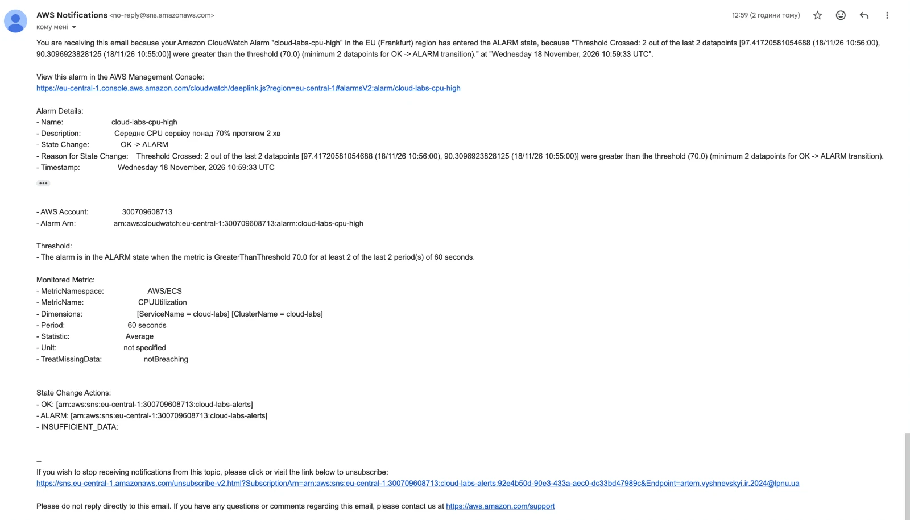
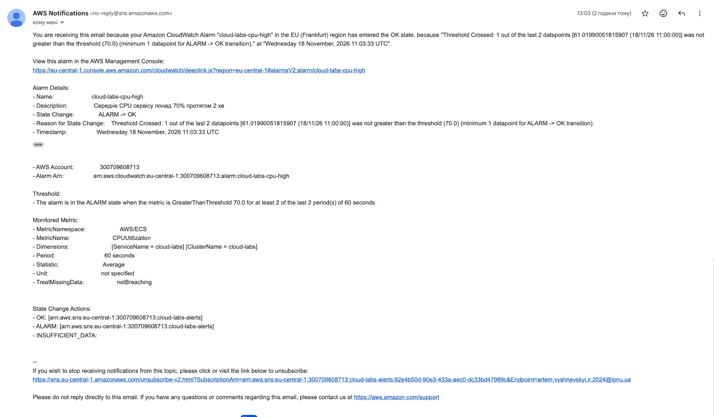

# Сповіщення

## Правило і канал

| Параметр | Значення | Де в Terraform |
|---|---|---|
| Метрика | `CPUUtilization`, простір імен `AWS/ECS`, середнє по сервісу | `alerts.tf` |
| Умова | понад 70 % у 2 з 2 хвилинних точок | `alert_cpu_threshold`, `alert_evaluation_minutes` |
| Канал | тема SNS `cloud-labs-alerts` з підпискою `email` | `aws_sns_topic`, `aws_sns_topic_subscription` |
| Листи | при переході в `ALARM` і при поверненні в `OK` | `alarm_actions`, `ok_actions` |

Після `terraform apply` AWS надсилає на пошту лист «Subscription Confirmation»; без натискання
Confirm subscription жодних сповіщень не буде.

## Обґрунтування умови

Ціль автоскейлінгу 50 %, поріг тривоги 70 %. Автоскейлінг спрацьовує сам і не потребує людини, тому тривога
має лунати лише тоді, коли CPU вище цілі настільки, що політика не встигає за навантаженням.
Вимога «2 хвилини поспіль» відсікає поодинокі стрибки і запобігає нестабільному спрацьовуванню (flapping):
без неї тривога перемикалась би між `ALARM` і `OK` на кожному короткому піку, і листи перестали б читати.
`treat_missing_data = notBreaching`: якщо метрики немає (сервіс зупинено), тривога не вмикається.

## Прогін

Той самий прогін `nocache`, що й у `docs/AUTOSCALING.md`; усі часи київські.

| Час | Подія |
|---|---|
| 12:55:41 | початок сталої фази |
| 12:59:33 | тривога перейшла в `ALARM`, SNS надіслав перший лист |
| 13:03:33 | тривога повернулась в `OK`, SNS надіслав другий лист |

Знімки листів, одержаних на пошту:

## Час реакції

Від початку сталої фази до першого листа минуло 3 хв 52 с (від початку тесту — 5 хв 52 с). Затримка складається з:

1. CPU перетнув 70 % у першу ж хвилину сталої фази, але метрика ECS публікується з запізненням близько 1 хвилини;
2. дві хвилини оцінювання за умовою «2 з 2»;
3. кілька секунд на доставку SNS і лист.

Для сервісу, де автоскейлінг сам усуває проблему, така реакція прийнятна: лист повідомляє «ресурси
закінчуються», а не «сервіс лежить». Для виявлення відмови, яку бачать користувачі, 4 хвилини забагато;
там потрібне окреме сповіщення на латентність p95 або частку 5xx з періодом у 1 хвилину.
