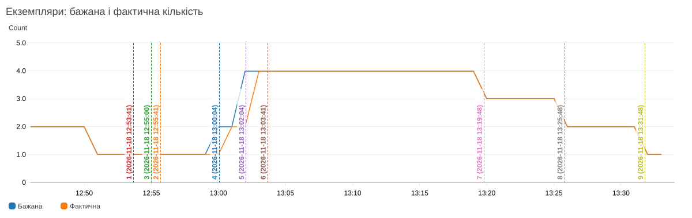
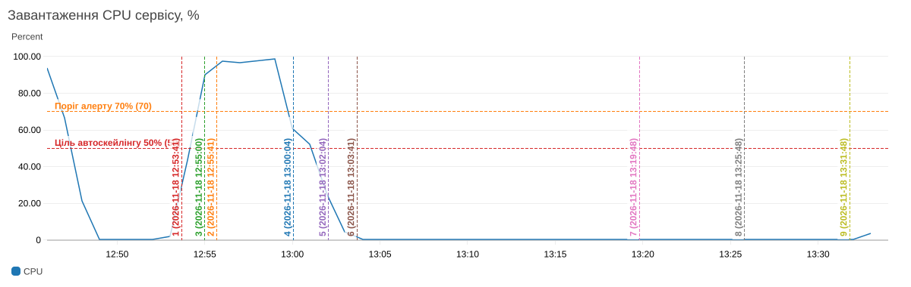
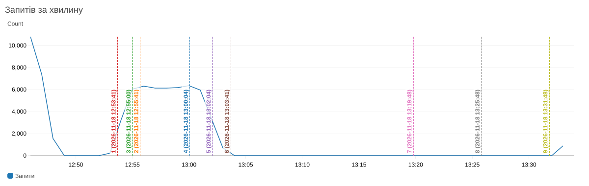
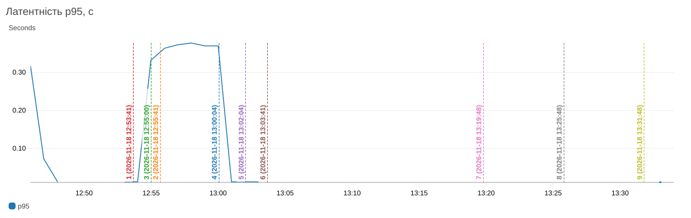
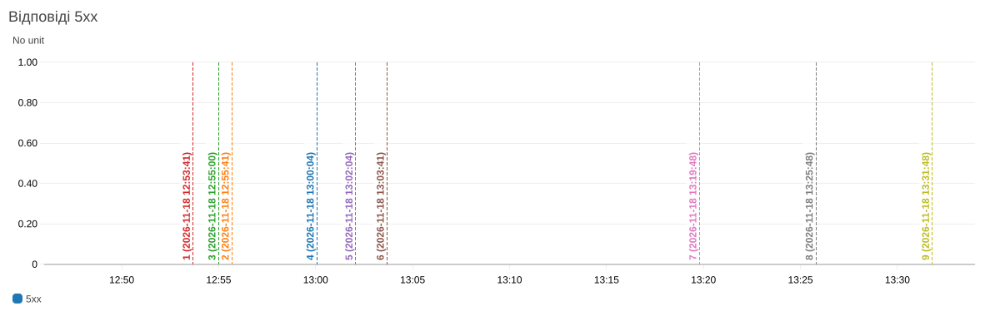

# Автоматичне масштабування

## Параметри політики

| Параметр | Значення | Де в Terraform |
|---|---|---|
| Мінімум екземплярів | 1 | `min_instances` |
| Максимум екземплярів | 4 | `max_instances` |
| Метрика | `ECSServiceAverageCPUUtilization` (середнє CPU по сервісу) | `autoscaling.tf` |
| Цільове значення | 50 % | `cpu_target_percent` |
| Cooldown після додавання | 60 с | `scale_out_cooldown` |
| Cooldown після вилучення | 300 с | `scale_in_cooldown` |

Тип політики — `TargetTrackingScaling`: Application Auto Scaling сам створює дві тривоги CloudWatch
(`AlarmHigh` і `AlarmLow`) і підбирає кількість екземплярів так, щоб середнє CPU трималось біля цілі.

## Чому саме 50 %

Задача Fargate має 0.25 vCPU. Новий екземпляр запускається 1–2 хвилини (завантаження образу, старт
Python, перевірки ALB), весь цей час решта екземплярів працює під повним навантаженням.
Тому ціль має залишати запас: при 50 % екземпляр має ще половину ресурсу на сплеск, поки підіймається
наступний. Спершу ціль була 60 %. Пробні прогони показали, що екземпляр насичується за одну хвилину (CPU від 40 % до 90 %),
тому ціль знижено до 50 %, щоб рішення про додавання приходило раніше. Навіть так воно прийшло наприкінці сталої
фази: це природна межа реакції target tracking (див. нижче).

Cooldown додавання короткий (60 с): недолік потужності шкодить користувачам одразу.
Cooldown вилучення довгий (300 с): зайвий екземпляр коштує копійки, а помилкове вилучення з наступним
додаванням коштує помилок для користувачів.

## Що таке cooldown і що буде при нулі

Cooldown (період стабілізації) — пауза після масштабування, протягом якої політика не виконує нових дій
у тому ж напрямку. Вона потрібна, бо метрика запізнюється: щойно доданий екземпляр ще не почав приймати запити,
і середнє CPU все ще високе.

При `scale_out_cooldown = 0` політика на кожній перевірці бачила б ще високе CPU і додавала б екземпляри
знову й знову, не чекаючи ефекту від попередніх: сервіс різко «перескочив» би потрібну кількість до максимуму.
При `scale_in_cooldown = 0` екземпляр вилучався б одразу після короткого спаду, наступний сплеск знову
вимагав би додавання, і кількість екземплярів «гойдалась» би (flapping), а запити на вилучених екземплярах
переривались би.

## Прогін під навантаженням

Сценарій з `docs/LOADTEST.md` (60 віртуальних користувачів, 10 хвилин), кеш вимкнений.
Графіки побудовано за тими ж метриками, що й дашборд CloudWatch `cloud-labs`
(CloudWatch `GetMetricWidgetImage`). Усі часи — київські (UTC+2).

| № | Час | Подія |
|---|---|---|
| 1 | 12:53:41 | початок навантаження |
| 2 | 12:55:41 | початок сталої фази (60 користувачів) |
| 3 | 12:55:00 | CPU перетнув ціль 50 % (90 % за цю хвилину) |
| 4 | 13:00:04 | політика збільшила бажану кількість 1 → 2 |
| 5 | 13:02:04 | бажана кількість 2 → 4 |
| 6 | 13:03:41 | кінець навантаження |
| 7 | 13:19:48 | вилучення: 4 → 3 |
| 8 | 13:25:48 | вилучення: 3 → 2 |
| 9 | 13:31:48 | вилучення: 2 → 1, сервіс повернувся до мінімуму |

## Чому між перетином порогу і появою екземпляра минає час

Від перетину порогу (3) до рішення про додавання (4) минуло близько 5 хвилин. Затримка складається з:

1. CloudWatch отримує метрику CPU раз на хвилину і публікує її з запізненням у 1–2 хвилини.
2. Тривога `AlarmHigh` потребує трьох послідовних точок вище цілі (3 хвилини), щоб не реагувати на короткий сплеск.
3. Після рішення задача Fargate має стартувати: завантажити образ, запустити Python, пройти дві перевірки
   `/health` балансувальника (по 15 с) — загалом ще 1–2 хвилини.

Тому на графіку CPU стоїть близько 95 % протягом кількох хвилин, і лише потім з'являються нові екземпляри.

## Чому вилучення відбувається значно пізніше за спад навантаження

Навантаження зникло о 13:03:41, а перше вилучення було о 13:19:48, тобто через 16 хвилин; повернення
до мінімуму — через 28 хвилин. Причини:

1. Тривога `AlarmLow` потребує 15 хвилин поспіль нижче цілі: політика навмисно асиметрична.
   Додати зайвий екземпляр дешево, а вилучити зарано означає нові помилки під наступним сплеском.
2. Між вилученнями діє cooldown 300 с, тому кількість зменшується по одному екземпляру (4 → 3 → 2 → 1).
3. Вилучений екземпляр спершу виводиться з балансувальника (`deregistration_delay` = 30 с),
   отримує SIGTERM і завершує поточні запити.
