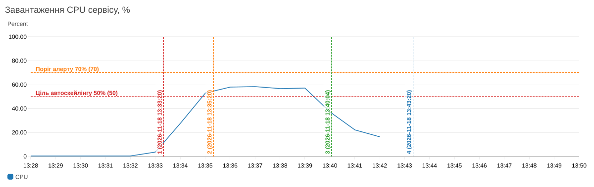
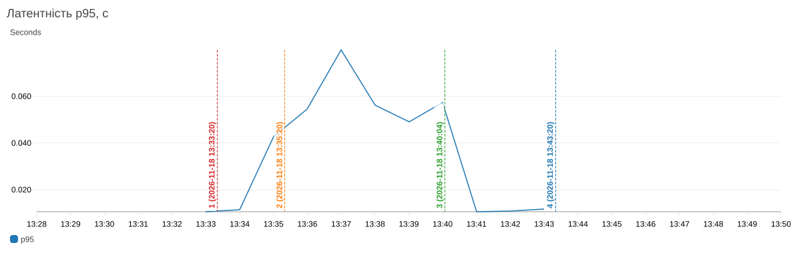
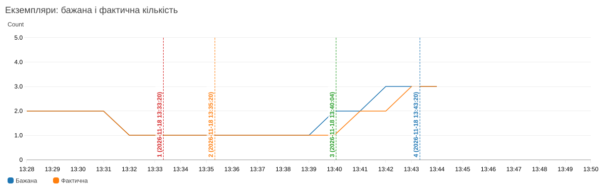

# Кешування

## Що закешовано і як

Найнавантаженіша операція читання — `GET /posts` (список постів): у сценарії це 5 із 9 читань
(`docs/LOADTEST.md`). Вона працює за схемою cache-aside (`app/routers/posts.py`, `app/cache.py`):

1. сервіс будує ключ `posts:list:<limit>:<offset>` і шукає його в Redis;
2. якщо запис є і термін його дії не сплив — повертає його з заголовком `X-Cache: HIT`;
3. інакше читає з PostgreSQL, зберігає відповідь у Redis з терміном дії 30 с (`CACHE_TTL_SECONDS`)
   і повертає її з `X-Cache: MISS`.

Кеш — Amazon ElastiCache for Redis 7.1 (`cache.t4g.micro`, `terraform/app/cache.tf`) у приватних підмережах.
Доступ лише з групи безпеки застосунку на порту 6379. Якщо Redis недоступний, сервіс читає з бази
(відмова кешу не ламає API). Заголовок `Cache-Control: no-cache` у запиті обходить кеш (`X-Cache: BYPASS`):
саме так у тесті вимикається кеш без перевипуску застосунку.

## Результати

Однаковий сценарій (`docs/LOADTEST.md`), обидва прогони стартували з одного екземпляра.

| Показник | Без кешу | З кешем |
|---|---|---|
| Запитів за секунду (середнє) | 84.3 | 96.7 |
| Латентність p95, усі запити | 390 мс | 130 мс |
| Латентність p95, `GET /posts` | 360 мс | 130 мс |
| Латентність p50, `GET /posts` | 50 мс | 43 мс |
| Помилок | 0 | 0 |
| CPU екземпляра ECS (стала фаза) | 96 % | 57 % |
| CPU бази RDS (стала фаза, середнє) | 15.3 % | 9.8 % |
| З'єднань з базою (максимум) | 15 | 5 |
| Екземплярів за прогін | 1 → 4 | 1 → 3 (лише в самому кінці) |

Частка влучань у кеш для `GET /posts`: 28 877 влучань і 70 промахів, тобто **99.8 %**.
Без кешу весь трафік ішов в обхід (`BYPASS`, 25 236 запитів).

Висновки з таблиці: кеш прибрав 5 із 9 читань із бази, тож база навантажена на третину менше за CPU,
а контейнер при тому ж потоці запитів працює на 57 % замість 96 %. Через це масштабування не знадобилось
майже до кінця тесту. Малу різницю p50 пояснює те, що більшість запитів (і з кешем, і без) і так швидкі:
виграє найповільніший «хвіст» p95/p99.

Графіки прогону з кешем:  

## Скільки клієнт бачить застарілі дані

Після запису (`POST /posts`) запис кешу не змінюється, тому новий пост з'являється у списку лише після
спливу терміну дії запису: **до 30 секунд** (TTL). Конкретний пост за ідентифікатором (`GET /posts/{id}`)
у кеш не потрапляє і видно одразу.

Зменшити це можна двома способами:

1. скоротити TTL — простіше, але більше промахів і навантаження на базу;
2. інвалідація при записі: після `POST`/`DELETE` видаляти ключі `posts:list:*` (або тримати в ключі номер
   версії, який збільшується при кожному записі). Дані стають актуальними одразу, а TTL залишається
   запобіжником на випадок збою інвалідації.

## Чому кеш у пам'яті процесу не підходить

При кількох екземплярах кожен тримав би власну копію: клієнт, якого балансувальник перекидає між
екземплярами, бачив би то свіжий, то застарілий список; інвалідація на одному екземплярі не доходила б
до інших; і копії дублювали б пам'ять. Спільний Redis дає один кеш на всі екземпляри.
